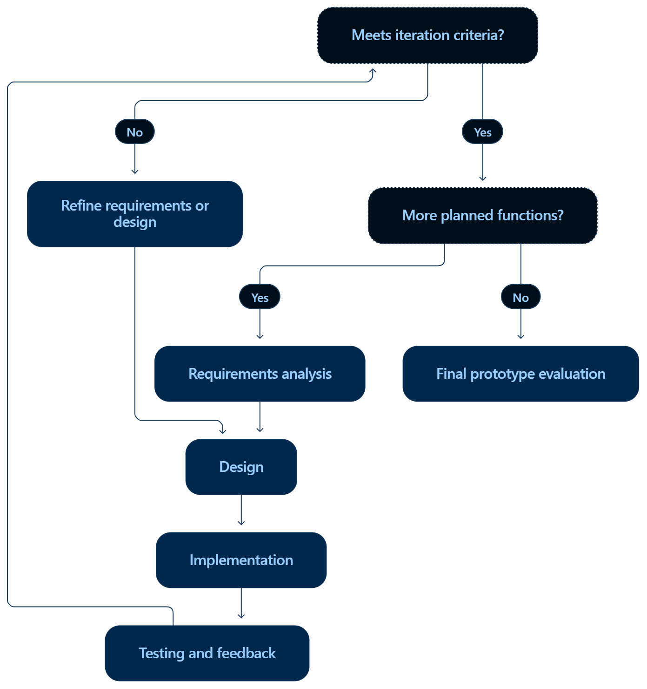

# Nuru

> **Nuru is a Digital Return Information Management System** that provides organized, source-linked, and verification-dated information for refugees considering voluntary return. The initial MVP allows administrators to publish return-related information and allows users to browse, search, filter, read, and report potentially outdated information.

## Description

Nuru is a full-stack web platform that provides verified, searchable information to help displaced people make informed decisions about voluntary return. Administrators publish and manage information entries. Users browse, search, filter by category and destination, read detailed entries, and report outdated content.

## GitHub Repository

[https://github.com/abu00123/Nuru](https://github.com/abu00123/Nuru)

## Video Demo

[Watch the demo on Google Drive](https://drive.google.com/drive/folders/1zUbNJ20X7dENxw5n-wL5GDB7oSWUOisk?usp=drive_link)

## Problem

Refugees and displaced people considering voluntary return often cannot find reliable, verified information about conditions back home — safety, schools, healthcare, housing, and documentation. Nuru solves this by providing a clean, searchable platform where verified information is published and maintained by trusted administrators.

## MVP Features

**Public — no account required**
- Browse and search verified information
- Filter by category and destination
- Read full information entries with source and verification details
- Report outdated information

**Admin — authenticated access only**
- Log in via JWT-authenticated admin panel
- Create, edit, and publish information entries
- Source name and URL required before an entry can be published
- Manage categories and destinations
- View and update submitted reports

## Access Model

Nuru uses an open-access model for public information. Refugees and other users can browse and search verified return information without creating an account. Authentication is reserved for authorized administrators responsible for managing and publishing content. This approach reduces access barriers while protecting administrative functions.

## Technology Stack

| Layer | Technology | Why |
|-------|------------|-----|
| Frontend | React 18, TypeScript, Vite | Component-based UI, type safety, fast dev server |
| Routing | React Router v6 | Client-side navigation with URL-based filter state |
| HTTP | Axios | Interceptors for JWT attachment and 401 handling |
| Backend | Django 5, Django REST Framework | Rapid API development, built-in admin, ORM |
| Auth | djangorestframework-simplejwt | Stateless JWT — fits a decoupled frontend/backend |
| Database | PostgreSQL | Relational integrity for FK relationships across models |
| Deployment | Vercel (frontend), Render (backend + DB) | Free tier, GitHub integration, zero-config deploys |
| Styling | Inline styles with design tokens | No build step, consistent across components |

## System Architecture

```
Browser (React + TypeScript — public + admin)
React Native / Expo (mobile prototype)
          ↕ HTTP / JSON (Axios)
Django REST Framework (port 8000)
          ↕ SQL
PostgreSQL Database

─────────────────────────────────
Deployment Architecture:

GitHub
  ├── frontend/ ──→ Vercel
  └── backend/  ──→ Render
                      └── Render PostgreSQL
```

## Database Design

### ERD

```
Category                    Destination
────────                    ───────────
id (PK)                     id (PK)
name                        country
description                 province
    │ 1                     commune
    │                           │ 1
    │ ∞                         │ ∞
    └──────→ InformationEntry ←─┘
             ────────────────
             id (PK)
             title
             summary
             content
             category_id (FK)
             destination_id (FK)
             source_name
             source_url
             verification_status
             last_verified
             is_published
             created_at
             updated_at
                 │ 1
                 │ ∞
                 ↓
              Report
              ──────
              id (PK)
              information_entry_id (FK)
              reason
              comment
              status
              created_at
```

### Relationships

- Category → InformationEntry: One-to-Many
- Destination → InformationEntry: One-to-Many
- InformationEntry → Report: One-to-Many

## Setup Instructions

### Prerequisites

- Python 3.10+
- Node.js 18+
- PostgreSQL running locally

### Backend Setup

```bash
cd backend

# Create and activate virtual environment
python -m venv venv
venv\Scripts\activate          # Windows
source venv/bin/activate       # Mac/Linux

# Install dependencies
pip install -r requirements.txt

# Create PostgreSQL database
psql -U postgres -c "CREATE DATABASE nuru;"

# Configure environment
cp .env.example .env
# Edit .env — minimum required values:
```

**.env (backend)**

```
SECRET_KEY=your-secret-key-here
DEBUG=True
DB_NAME=nuru
DB_USER=postgres
DB_PASSWORD=your-password
DB_HOST=localhost
DB_PORT=5432
ALLOWED_HOSTS=localhost,127.0.0.1
CORS_ALLOWED_ORIGINS=http://localhost:5173
```

```bash
# Run migrations
python manage.py makemigrations information reports users
python manage.py migrate

# Create admin user
python manage.py createsuperuser

# Start server
python manage.py runserver
```

Backend runs at: `http://localhost:8000`

### Frontend Setup

```bash
cd frontend

# Install dependencies
npm install
```

**.env (frontend)**

```
VITE_API_BASE_URL=http://localhost:8000/api
```

```bash
# Start dev server
npm run dev
```

Frontend runs at: `http://localhost:5173`

## FR04 Source Dates

Entries store an optional source publication date, displayed as **Unknown** when
absent. This is the cited source's publication date, not the entry creation date.
The public API's `last_verified` value and the admin's current source-check date
are derived from a suitable source review for the current content version.
Older manually entered dates are retained in storage for compatibility but are
not used as evidence of a current-version check. Clients cannot set the derived date.

Set source publication dates through Django admin or the React information editor.
Changing a date creates a new content version and requires a new review before
publication. Revision snapshots preserve dates saved after this upgrade. No source
publication dates are inferred for existing entries.

Apply `python manage.py migrate` from `backend/` before using these fields.
Four date tests cover missing dates, current-version reviews and invalidation after
edits, saved publication dates and snapshots, and invalid/manual date inputs.
The combined suite has 28 passing tests using SQLite; the frontend production build
also passes. PostgreSQL and browser validation should be recorded separately.

## FR02 Keyword Search

Keyword search matches entry titles, summaries, and full content without regard to
case. Reviewed Kirundi, Kinyarwanda, and Kiswahili translations are searched across
the same fields. Unreviewed translations do not supply matches, and unpublished
entries remain hidden from public users. A search with no matches returns an empty
list, displayed as **No information found** in Explore.

Four search tests cover English title/summary/content matches, reviewed translation
content in all three languages, exclusion of drafts and unreviewed translations,
and empty results. Run `python manage.py test --settings=config.test_settings --noinput`
from `backend/` for the combined 24-test suite (SQLite).

## FR11 Report Resolution

Reports use Open (`pending`), In progress (`reviewed`), and Resolved (`resolved`)
statuses. Existing API status values are retained for compatibility. Administrators
must enter resolution notes before resolving a report. The API and Django admin
automatically record the responsible administrator and resolution date; clients
cannot supply those values. Reopening clears the current resolution details, and
changing the resolution notes records the administrator and time of that change.
This stores the current outcome rather than a full report-event history.

In Django admin, open **Reports**, select a report, enter **Resolution notes**, set
**Status** to Resolved, and save. In the React admin dashboard, enter resolution
notes beside the report before selecting Resolved. The reviewer and date appear
after saving. Existing resolved reports are not assigned invented attribution;
open and complete their resolution details as needed.

Apply the new reports migration with `python manage.py migrate`. Run the combined
19-test API, model, and admin suite with
`python manage.py test --settings=config.test_settings --noinput` from `backend/`.
The five report tests cover required notes, server-owned attribution, reopening,
public submission restrictions, and the Django admin resolution workflow.

## FR12 Revision History

Article creation and substantive edits preserve saved content in version snapshots,
including source details, translations, guides, and category/destination labels.
In Django admin, open an information entry and follow a link in **Entry revisions**,
or open **Entry revisions** from the admin home. Each read-only revision displays
its saved content and the source reviews for that version, including reviewer,
review date, outcome, and notes. Administrators need view permission for entry
revisions; superusers already have it.

Apply the upgrade from `backend/` with the virtual environment activated:

```powershell
python manage.py migrate
```

The migration captures each existing entry's current version. Previously overwritten
versions cannot be recovered. Capture time is when the snapshot was stored, not an
inferred historical edit date. Entries with revision history cannot be hard-deleted;
unpublish them to retain their history. Bulk ORM updates bypass snapshot creation;
use the admin or API editing workflow.

Revision tests cover preservation of earlier text and nested guide content, unchanged
saves, partial saves, upgrade capture, and admin-only read-only inspection with
matching source reviews. The combined FR09/FR12 suite contains 14 tests.

## FR09 Automated Tests

From `backend/`, with the virtual environment activated, run:

```powershell
python manage.py test --settings=config.test_settings --noinput
```

This uses an isolated in-memory SQLite database, applies the project migrations,
and leaves the configured PostgreSQL database untouched. It is a local workflow
check, not PostgreSQL compatibility or performance evidence. To test against a
configured PostgreSQL server with test-database creation permissions, run
`python manage.py test --noinput`.

The nine API integration tests cover rejection of publication without a suitable
review, source requirements, review attribution, successful publication, rejection
of substantive edits that reuse an old review, draft editing and fresh review
before republication, public draft visibility, and administrative permissions.

When changing published content, uncheck **Published** and save the revised draft,
record a suitable source review for its new version, then publish again. Attempting
to save substantive changes while keeping the entry published is rejected.

Validation: all nine tests passed using the isolated SQLite settings. The tests
initially exposed acceptance of published content edits using the pre-edit version's
review; publication validation now checks the version that will be saved.

## API Endpoints

| Method | Endpoint | Auth | Description |
|--------|----------|------|-------------|
| GET | `/api/information/` | Public | List all published entries |
| GET | `/api/information/?search=school` | Public | Search entries by keyword |
| GET | `/api/information/?category=Education` | Public | Filter by category |
| GET | `/api/information/?destination=Kirundo` | Public | Filter by destination |
| GET | `/api/information/:id/` | Public | Retrieve single entry |
| POST | `/api/information/` | Admin | Create new entry |
| PUT | `/api/information/:id/` | Admin | Update entry |
| GET | `/api/categories/` | Public | List all categories |
| GET | `/api/destinations/` | Public | List all destinations |
| POST | `/api/reports/` | Public | Submit a report |
| GET | `/api/reports/` | Admin | List all reports |
| PATCH | `/api/reports/:id/` | Admin | Update report status |
| POST | `/api/auth/token/` | — | Obtain JWT token |
| POST | `/api/auth/token/refresh/` | — | Refresh JWT token |

## Code Highlights

### Django Model — InformationEntry

```python
class InformationEntry(models.Model):
    STATUS_CHOICES = [
        ('verified', 'Verified'),
        ('unverified', 'Unverified'),
        ('outdated', 'Outdated'),
    ]

    title = models.CharField(max_length=255)
    summary = models.TextField()
    content = models.TextField()
    category = models.ForeignKey(Category, on_delete=models.SET_NULL, null=True)
    destination = models.ForeignKey(Destination, on_delete=models.SET_NULL, null=True)
    source_name = models.CharField(max_length=255, blank=True)
    source_url = models.URLField(blank=True)
    verification_status = models.CharField(max_length=20, choices=STATUS_CHOICES, default='unverified')
    last_verified = models.DateField(null=True, blank=True)
    is_published = models.BooleanField(default=False)
    created_at = models.DateTimeField(auto_now_add=True)
    updated_at = models.DateTimeField(auto_now=True)
```

### Django REST API View — Search, Filter, and Auth-aware Queryset

```python
class InformationEntryListCreateView(generics.ListCreateAPIView):
    serializer_class = InformationEntrySerializer

    def get_permissions(self):
        if self.request.method == 'POST':
            return [IsAdminUser()]
        return [AllowAny()]

    def get_queryset(self):
        # Admins see all entries including drafts; public sees published only
        if self.request.user and self.request.user.is_staff:
            queryset = InformationEntry.objects.all()
        else:
            queryset = InformationEntry.objects.filter(is_published=True)

        search = self.request.query_params.get('search')
        category = self.request.query_params.get('category')
        destination = self.request.query_params.get('destination')

        if search:
            queryset = queryset.filter(title__icontains=search) | \
                       queryset.filter(summary__icontains=search)
        if category:
            queryset = queryset.filter(category__name__iexact=category)
        if destination:
            queryset = queryset.filter(destination__commune__iexact=destination)

        return queryset
```

### Axios API Service — JWT Interceptors

```typescript
const api = axios.create({
  baseURL: import.meta.env.VITE_API_BASE_URL || 'http://localhost:8000/api',
  headers: { 'Content-Type': 'application/json' },
});

// Attach token to every request
api.interceptors.request.use(config => {
  const token = localStorage.getItem('access_token');
  if (token) config.headers.Authorization = `Bearer ${token}`;
  return config;
});

// Redirect to login on 401
api.interceptors.response.use(
  res => res,
  err => {
    if (err.response?.status === 401) {
      localStorage.removeItem('access_token');
      window.location.href = '/login';
    }
    return Promise.reject(err);
  }
);
```

### React Search and Filter — Explore Page

```typescript
const [entries, setEntries] = useState<InformationEntry[]>([]);
const search = searchParams.get('search') || '';
const category = searchParams.get('category') || '';

useEffect(() => {
  getInformation({ search, category, destination })
    .then(r => setEntries(r.data))
    .finally(() => setLoading(false));
}, [search, category, destination]);
```

## UI Design

### Style Guide

| Token | Value |
|-------|-------|
| Primary | `#1a3c2e` (deep green) |
| Background | `#f8faf9` (off-white) |
| Text | `#1e293b` (dark charcoal) |
| Success | `#1a7a45` (green) |
| Warning | `#b45309` (amber) |
| Border | `#e2e8f0` (light grey) |
| Font | Inter, system-ui, sans-serif |

### Screens and Navigation

| Screen | Route | Access |
|--------|-------|--------|
| Home | `/` | Public |
| Explore | `/explore` | Public |
| Information Detail | `/information/:id` | Public |
| Report Information | `/report/:id` | Public |
| Admin Login | `/login` | Public |
| Admin Dashboard | `/admin` | Admin only |
| Add Information | `/admin/new` | Admin only |
| Edit Information | `/admin/edit/:id` | Admin only |

### Screenshots

**Home**


**Explore**


**Information Detail**


**Report Form**


**Admin Login**


**Admin Dashboard**


**Add Information**


### System Diagrams



### User Flow — Public

```
Home (search or pick category)
  └──→ Explore (browse, filter by category/destination)
         └──→ Information Detail (read full entry + source)
                └──→ Report Information (submit outdated report)
```

### User Flow — Admin

```
Login (/login)
  └──→ Admin Dashboard (view all entries + reports, update report status)
         ├──→ Add Information (/admin/new)
         └──→ Edit Information (/admin/edit/:id)
```

### Responsive Design

All layouts use CSS flexbox and grid with `clamp()` for fluid typography and `auto-fill` grid columns that reflow on smaller screens.

## Demo Flow

1. Open `http://localhost:5173` → home page loads with category grid fetched from the API
2. Click a category or type a search term → Explore page filters results
3. Click **View information** on any entry → read full detail with source and verification status
4. Click **Report outdated information** → submit the form → success confirmation
5. Click **Admin** in the navbar → redirected to `/login`
6. Log in with superuser credentials → Admin Dashboard
7. See all entries including drafts (grey "Draft" pill on unpublished entries)
8. Click **+ Add Information** → fill form → tick Publish → save → entry appears on the public site
9. Back on the dashboard → change a report status from the dropdown → updates instantly

This flow demonstrates the complete chain:

```
Admin publishes → PostgreSQL stores → React fetches → User reads → User reports → PostgreSQL stores → Admin reviews
```

## Deployment

### Frontend — Vercel

1. Push repo to GitHub
2. Connect repo to Vercel
3. Set root directory to `frontend`
4. Add environment variable: `VITE_API_BASE_URL=https://your-backend.onrender.com/api`
5. Deploy

### Backend — Render

1. Create a new Web Service on Render
2. Connect GitHub repo, set root directory to `backend`
3. Build command: `pip install -r requirements.txt`
4. Start command: `gunicorn config.wsgi:application`
5. Add environment variables:
   ```
   SECRET_KEY=...
   DEBUG=False
   ALLOWED_HOSTS=your-backend.onrender.com
   CORS_ALLOWED_ORIGINS=https://your-frontend.vercel.app
   DB_NAME=...
   DB_USER=...
   DB_PASSWORD=...
   DB_HOST=...
   DB_PORT=5432
   ```
6. Create a Render PostgreSQL database and link it

## Mobile Prototype

A React Native + Expo companion app (`nuru-mobile/`) shares the same Django REST API. It targets Android and iOS but has not yet been verified on a physical device or emulator.

Features implemented:
- Browse, search, and filter published information by category and destination
- Read full entries with verification status, date, and source links
- Submit reports via the existing anonymous endpoint
- Save article IDs on the device (bookmarks — requires a live connection to read content)
- Language selector and step guides per article
- Android hardware back button and safe area support

Component structure: `AppContent` manages navigation and screen state. Separate components handle language selection (`LanguageSelector`), saved articles (`SavedArticles`), article actions (`ArticleActions`), and step guides (`StepGuide`). Administration remains in the web app; no login is required for public mobile features.

Offline content caching, push notifications, and store releases are future work.

## Repository Structure

```
nuru/
├── frontend/
│   ├── src/
│   │   ├── components/
│   │   ├── pages/
│   │   ├── services/
│   │   └── types/
│   └── package.json
├── nuru-mobile/
│   ├── src/
│   └── App.tsx
├── backend/
│   ├── config/
│   ├── information/
│   ├── reports/
│   ├── users/
│   └── requirements.txt
├── docs/
│   ├── wireframes/
│   ├── mockups/
│   └── screenshots/
└── README.md
```

## Language Support

The initial MVP uses English as the primary interface language. Multilingual support is planned for future iterations so that users can access information in languages appropriate to their needs. The system architecture will allow translated versions of information entries and interface text to be added without changing the core application workflow.

## Future Development

- Multilingual support (French, Kirundi)
- AI-assisted content verification
- WhatsApp and SMS access for low-connectivity users
- Map integration showing destination conditions
- Offline-first mobile experience (content caching — mobile prototype implemented but caching not yet added)
- Advanced role-based access control
- Automated source verification
