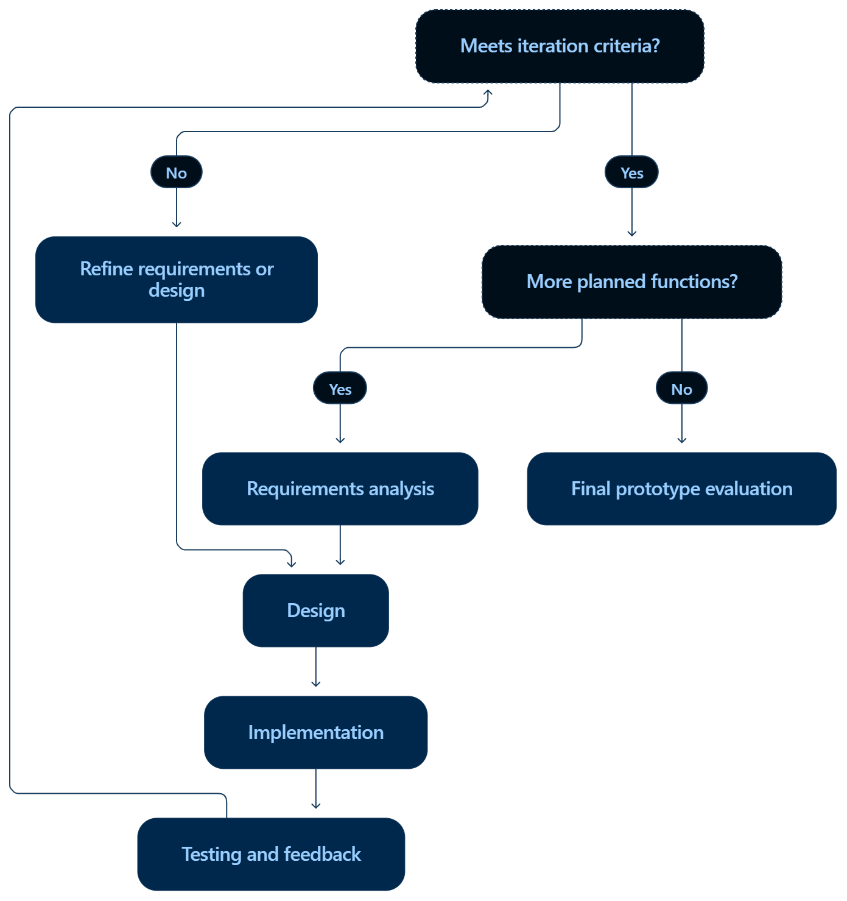

# Nuru

> **Nuru is a Digital Return Information Management System** that provides organized, source-linked, and verification-dated information for refugees considering voluntary return. The initial MVP allows administrators to publish return-related information and allows users to browse, search, filter, read, and report potentially outdated information.

## Description

Nuru is a full-stack web platform that provides verified, searchable information to help displaced people make informed decisions about voluntary return. Administrators publish and manage information entries. Users browse, search, filter by category and destination, read detailed entries, and report outdated content.

## GitHub Repository

<!-- Add your repo link here -->

## Video Demo

[Watch the demo on Google Drive](https://drive.google.com/drive/folders/1zUbNJ20X7dENxw5n-wL5GDB7oSWUOisk?usp=drive_link)

## Problem

Refugees and displaced people considering voluntary return often cannot find reliable, verified information about conditions back home — safety, schools, healthcare, housing, and documentation. Nuru solves this by providing a clean, searchable platform where verified information is published and maintained by trusted administrators.

## MVP Features

**Public — no account required**
- Browse and search verified information
- Filter by category and destination
- Read full information entries with source and verification details
- Report outdated information

**Admin — authenticated access only**
- Log in via JWT-authenticated admin panel
- Create, edit, and publish information entries
- Manage categories and destinations
- View and update submitted reports

## Access Model

Nuru uses an open-access model for public information. Refugees and other users can browse and search verified return information without creating an account. Authentication is reserved for authorized administrators responsible for managing and publishing content. This approach reduces access barriers while protecting administrative functions.

## Technology Stack

| Layer | Technology | Why |
|-------|------------|-----|
| Frontend | React 18, TypeScript, Vite | Component-based UI, type safety, fast dev server |
| Routing | React Router v6 | Client-side navigation with URL-based filter state |
| HTTP | Axios | Interceptors for JWT attachment and 401 handling |
| Backend | Django 5, Django REST Framework | Rapid API development, built-in admin, ORM |
| Auth | djangorestframework-simplejwt | Stateless JWT — fits a decoupled frontend/backend |
| Database | PostgreSQL | Relational integrity for FK relationships across models |
| Deployment | Vercel (frontend), Render (backend + DB) | Free tier, GitHub integration, zero-config deploys |
| Styling | Inline styles with design tokens | No build step, consistent across components |

## System Architecture

```
Browser (React + TypeScript)
          ↕ HTTP / JSON (Axios)
Django REST Framework (port 8000)
          ↕ SQL
PostgreSQL Database

─────────────────────────────────
Deployment Architecture:

GitHub
  ├── frontend/ ──→ Vercel
  └── backend/  ──→ Render
                      └── Render PostgreSQL
```

## Database Design

### ERD

```
Category                    Destination
────────                    ───────────
id (PK)                     id (PK)
name                        country
description                 province
    │ 1                     commune
    │                           │ 1
    │ ∞                         │ ∞
    └──────→ InformationEntry ←─┘
             ────────────────
             id (PK)
             title
             summary
             content
             category_id (FK)
             destination_id (FK)
             source_name
             source_url
             verification_status
             last_verified
             is_published
             created_at
             updated_at
                 │ 1
                 │ ∞
                 ↓
              Report
              ──────
              id (PK)
              information_entry_id (FK)
              reason
              comment
              status
              created_at
```

### Relationships

- Category → InformationEntry: One-to-Many
- Destination → InformationEntry: One-to-Many
- InformationEntry → Report: One-to-Many

## Setup Instructions

### Prerequisites

- Python 3.10+
- Node.js 18+
- PostgreSQL running locally

### Backend Setup

```bash
cd backend

# Create and activate virtual environment
python -m venv venv
venv\Scripts\activate          # Windows
source venv/bin/activate       # Mac/Linux

# Install dependencies
pip install -r requirements.txt

# Create PostgreSQL database
psql -U postgres -c "CREATE DATABASE nuru;"

# Configure environment
cp .env.example .env
# Edit .env — minimum required values:
```

**.env (backend)**

```
SECRET_KEY=your-secret-key-here
DEBUG=True
DB_NAME=nuru
DB_USER=postgres
DB_PASSWORD=your-password
DB_HOST=localhost
DB_PORT=5432
ALLOWED_HOSTS=localhost,127.0.0.1
CORS_ALLOWED_ORIGINS=http://localhost:5173
```

```bash
# Run migrations
python manage.py makemigrations information reports users
python manage.py migrate

# Create admin user
python manage.py createsuperuser

# Start server
python manage.py runserver
```

Backend runs at: `http://localhost:8000`

### Frontend Setup

```bash
cd frontend

# Install dependencies
npm install
```

**.env (frontend)**

```
VITE_API_BASE_URL=http://localhost:8000/api
```

```bash
# Start dev server
npm run dev
```

Frontend runs at: `http://localhost:5173`

## API Endpoints

| Method | Endpoint | Auth | Description |
|--------|----------|------|-------------|
| GET | `/api/information/` | Public | List all published entries |
| GET | `/api/information/?search=school` | Public | Search entries by keyword |
| GET | `/api/information/?category=Education` | Public | Filter by category |
| GET | `/api/information/?destination=Kirundo` | Public | Filter by destination |
| GET | `/api/information/:id/` | Public | Retrieve single entry |
| POST | `/api/information/` | Admin | Create new entry |
| PUT | `/api/information/:id/` | Admin | Update entry |
| GET | `/api/categories/` | Public | List all categories |
| GET | `/api/destinations/` | Public | List all destinations |
| POST | `/api/reports/` | Public | Submit a report |
| GET | `/api/reports/` | Admin | List all reports |
| PATCH | `/api/reports/:id/` | Admin | Update report status |
| POST | `/api/auth/token/` | — | Obtain JWT token |
| POST | `/api/auth/token/refresh/` | — | Refresh JWT token |

## Code Highlights

### Django Model — InformationEntry

```python
class InformationEntry(models.Model):
    STATUS_CHOICES = [
        ('verified', 'Verified'),
        ('unverified', 'Unverified'),
        ('outdated', 'Outdated'),
    ]

    title = models.CharField(max_length=255)
    summary = models.TextField()
    content = models.TextField()
    category = models.ForeignKey(Category, on_delete=models.SET_NULL, null=True)
    destination = models.ForeignKey(Destination, on_delete=models.SET_NULL, null=True)
    source_name = models.CharField(max_length=255, blank=True)
    source_url = models.URLField(blank=True)
    verification_status = models.CharField(max_length=20, choices=STATUS_CHOICES, default='unverified')
    last_verified = models.DateField(null=True, blank=True)
    is_published = models.BooleanField(default=False)
    created_at = models.DateTimeField(auto_now_add=True)
    updated_at = models.DateTimeField(auto_now=True)
```

### Django REST API View — Search, Filter, and Auth-aware Queryset

```python
class InformationEntryListCreateView(generics.ListCreateAPIView):
    serializer_class = InformationEntrySerializer

    def get_permissions(self):
        if self.request.method == 'POST':
            return [IsAdminUser()]
        return [AllowAny()]

    def get_queryset(self):
        # Admins see all entries including drafts; public sees published only
        if self.request.user and self.request.user.is_staff:
            queryset = InformationEntry.objects.all()
        else:
            queryset = InformationEntry.objects.filter(is_published=True)

        search = self.request.query_params.get('search')
        category = self.request.query_params.get('category')
        destination = self.request.query_params.get('destination')

        if search:
            queryset = queryset.filter(title__icontains=search) | \
                       queryset.filter(summary__icontains=search)
        if category:
            queryset = queryset.filter(category__name__iexact=category)
        if destination:
            queryset = queryset.filter(destination__commune__iexact=destination)

        return queryset
```

### Axios API Service — JWT Interceptors

```typescript
const api = axios.create({
  baseURL: import.meta.env.VITE_API_BASE_URL || 'http://localhost:8000/api',
  headers: { 'Content-Type': 'application/json' },
});

// Attach token to every request
api.interceptors.request.use(config => {
  const token = localStorage.getItem('access_token');
  if (token) config.headers.Authorization = `Bearer ${token}`;
  return config;
});

// Redirect to login on 401
api.interceptors.response.use(
  res => res,
  err => {
    if (err.response?.status === 401) {
      localStorage.removeItem('access_token');
      window.location.href = '/login';
    }
    return Promise.reject(err);
  }
);
```

### React Search and Filter — Explore Page

```typescript
const [entries, setEntries] = useState<InformationEntry[]>([]);
const search = searchParams.get('search') || '';
const category = searchParams.get('category') || '';

useEffect(() => {
  getInformation({ search, category, destination })
    .then(r => setEntries(r.data))
    .finally(() => setLoading(false));
}, [search, category, destination]);
```

## UI Design

### Style Guide

| Token | Value |
|-------|-------|
| Primary | `#1a3c2e` (deep green) |
| Background | `#f8faf9` (off-white) |
| Text | `#1e293b` (dark charcoal) |
| Success | `#1a7a45` (green) |
| Warning | `#b45309` (amber) |
| Border | `#e2e8f0` (light grey) |
| Font | Inter, system-ui, sans-serif |

### Screens and Navigation

| Screen | Route | Access |
|--------|-------|--------|
| Home | `/` | Public |
| Explore | `/explore` | Public |
| Information Detail | `/information/:id` | Public |
| Report Information | `/report/:id` | Public |
| Admin Login | `/login` | Public |
| Admin Dashboard | `/admin` | Admin only |
| Add Information | `/admin/new` | Admin only |
| Edit Information | `/admin/edit/:id` | Admin only |

### Screenshots

**Home**


**Explore**


**Information Detail**


**Report Form**


**Admin Login**


**Admin Dashboard**


**Add Information**


### System Diagrams



### User Flow — Public

```
Home (search or pick category)
  └──→ Explore (browse, filter by category/destination)
         └──→ Information Detail (read full entry + source)
                └──→ Report Information (submit outdated report)
```

### User Flow — Admin

```
Login (/login)
  └──→ Admin Dashboard (view all entries + reports, update report status)
         ├──→ Add Information (/admin/new)
         └──→ Edit Information (/admin/edit/:id)
```

### Responsive Design

All layouts use CSS flexbox and grid with `clamp()` for fluid typography and `auto-fill` grid columns that reflow on smaller screens.

## Demo Flow

1. Open `http://localhost:5173` → home page loads with category grid fetched from the API
2. Click a category or type a search term → Explore page filters results
3. Click **View information** on any entry → read full detail with source and verification status
4. Click **Report outdated information** → submit the form → success confirmation
5. Click **Admin** in the navbar → redirected to `/login`
6. Log in with superuser credentials → Admin Dashboard
7. See all entries including drafts (grey "Draft" pill on unpublished entries)
8. Click **+ Add Information** → fill form → tick Publish → save → entry appears on the public site
9. Back on the dashboard → change a report status from the dropdown → updates instantly

This flow demonstrates the complete chain:

```
Admin publishes → PostgreSQL stores → React fetches → User reads → User reports → PostgreSQL stores → Admin reviews
```

## Deployment

### Frontend — Vercel

1. Push repo to GitHub
2. Connect repo to Vercel
3. Set root directory to `frontend`
4. Add environment variable: `VITE_API_BASE_URL=https://your-backend.onrender.com/api`
5. Deploy

### Backend — Render

1. Create a new Web Service on Render
2. Connect GitHub repo, set root directory to `backend`
3. Build command: `pip install -r requirements.txt`
4. Start command: `gunicorn config.wsgi:application`
5. Add environment variables:
   ```
   SECRET_KEY=...
   DEBUG=False
   ALLOWED_HOSTS=your-backend.onrender.com
   CORS_ALLOWED_ORIGINS=https://your-frontend.vercel.app
   DB_NAME=...
   DB_USER=...
   DB_PASSWORD=...
   DB_HOST=...
   DB_PORT=5432
   ```
6. Create a Render PostgreSQL database and link it

## Repository Structure

```
nuru/
├── frontend/
│   ├── src/
│   │   ├── components/
│   │   ├── pages/
│   │   ├── services/
│   │   └── types/
│   └── package.json
├── backend/
│   ├── config/
│   ├── information/
│   ├── reports/
│   ├── users/
│   └── requirements.txt
├── docs/
│   ├── wireframes/
│   ├── mockups/
│   └── screenshots/
└── README.md
```

## Language Support

The initial MVP uses English as the primary interface language. Multilingual support is planned for future iterations so that users can access information in languages appropriate to their needs. The system architecture will allow translated versions of information entries and interface text to be added without changing the core application workflow.

## Future Development

- Multilingual support (French, Kirundi)
- AI-assisted content verification
- WhatsApp and SMS access for low-connectivity users
- Map integration showing destination conditions
- Offline-first mobile experience
- Advanced role-based access control
- Automated source verification
