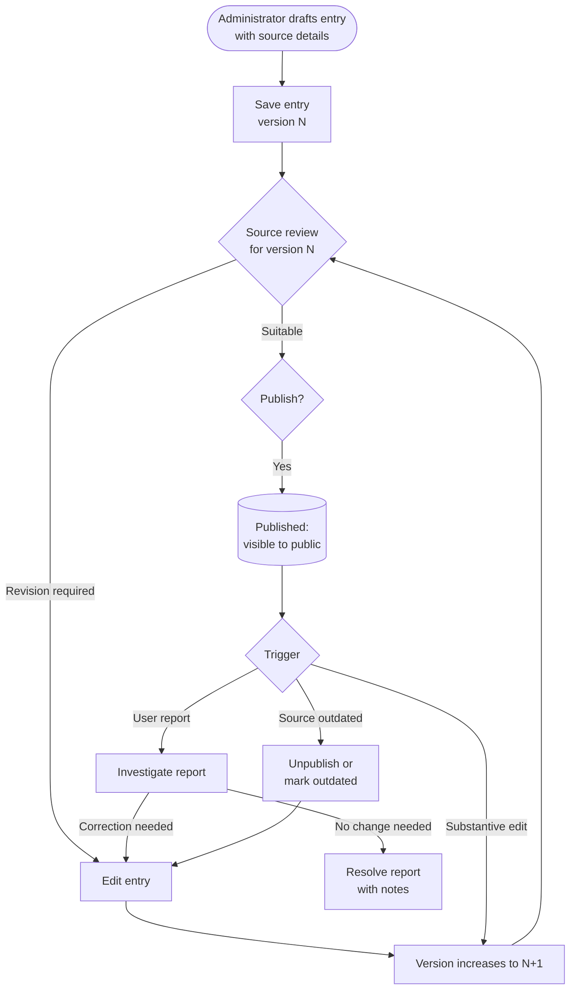
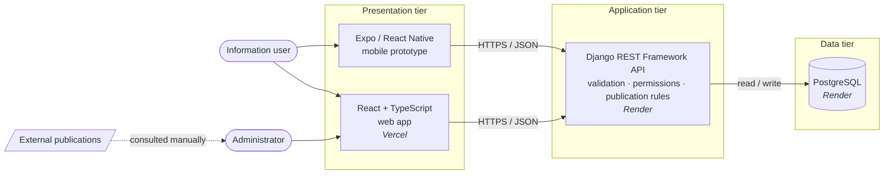
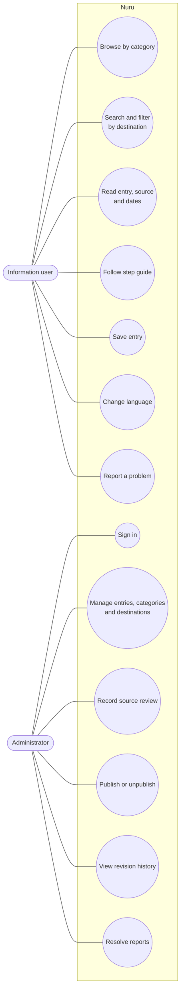
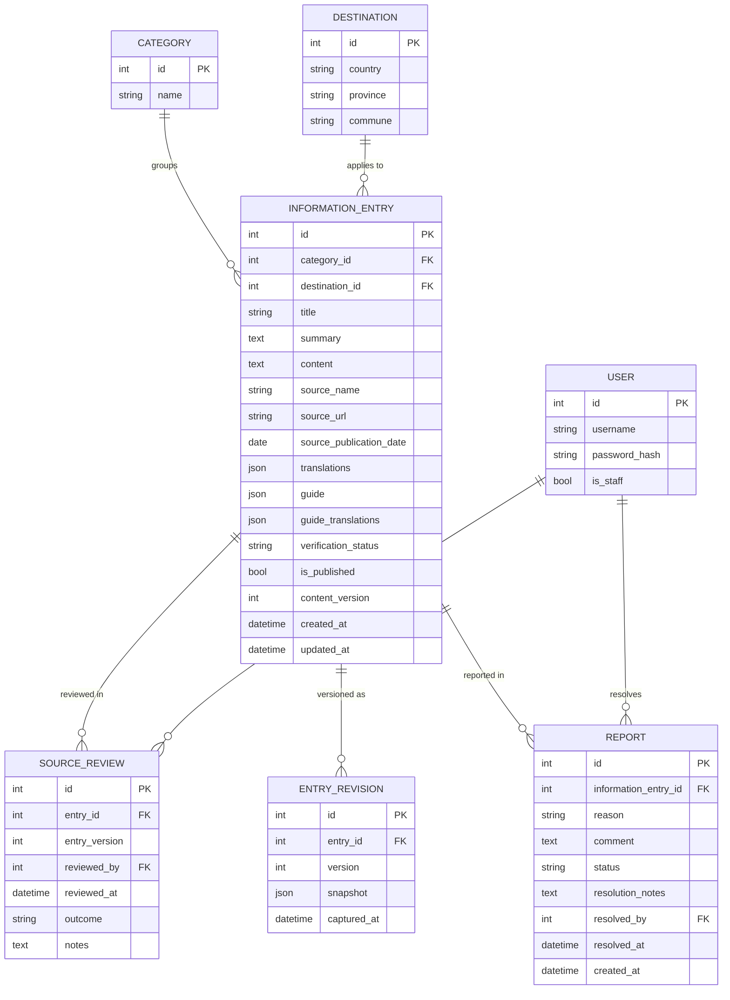
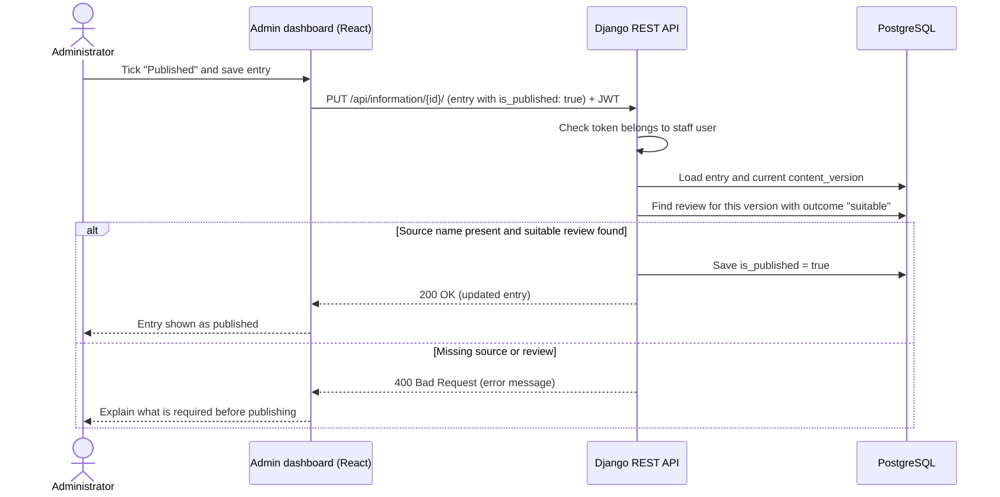

# Chapter Three diagrams (Mermaid)

To create each image: copy the code inside one block (without the ``` lines), paste it at https://mermaid.live, then use Actions → PNG (or SVG) to download. Insert into Word with the figure caption below it.

## Figure 3.2: Content review and publication workflow



## Figure 3.3: System architecture



## Figure 3.4: Use case diagram



## Figure 3.5: Entity–relationship diagram



## Figure 3.6: Publication sequence diagram


